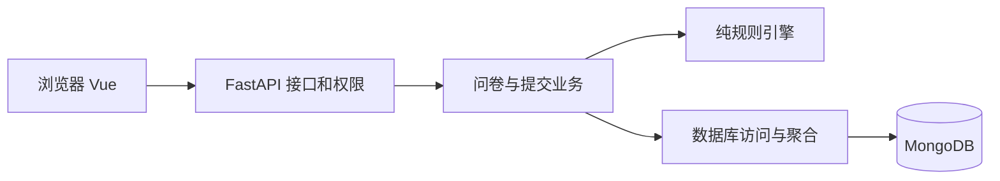
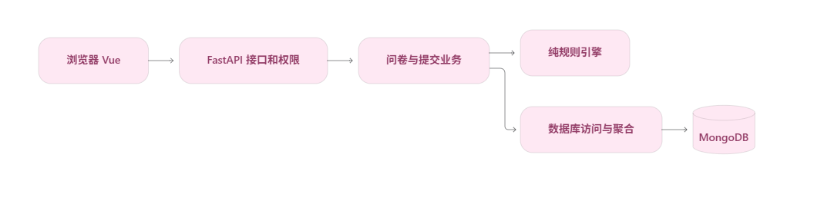
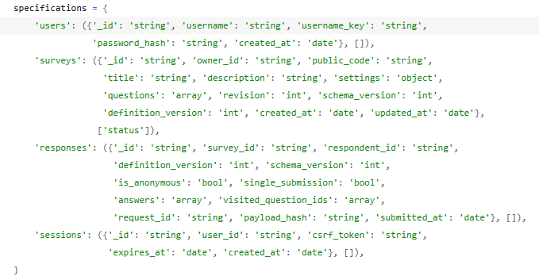

# 拾问问卷系统设计

## 目标和结构

系统覆盖第一阶段用户账号、问卷管理、条件跳转、答案校验、答卷保存及结果统计。前端为 Vue 3 与 TypeScript；后端为 FastAPI、Pydantic 和 PyMongo Async；唯一业务数据库为 MongoDB。

接口不承担跳转计算细节；业务组织状态和提交顺序；规则模块只接受定义和答案，返回规范化答案、真实路径和下一题。数据库连接在 lifespan 中创建和关闭，网络操作使用异步驱动。密码哈希在线程池运行，避免阻塞事件循环。

## 集合设计

| 集合 | 字段与含义 |
|---|---|
| users | `_id` 为 UUID 字符串；`username` 展示名；`username_key` 为 NFKC、去首尾空格、casefold 后的唯一值；`password_hash`；`created_at` |
| surveys | `_id`、`owner_id`、随机 `public_code`；标题说明；状态截止时间；匿名和重复设置；题目数组；三类版本；创建更新时间 |
| responses | `_id`、`survey_id`、`respondent_id`；定义版本；匿名及单次限制标记；答案数组；服务端计算的路径；请求 ID、请求摘要、受理时间 |
| sessions | `_id` 为随机令牌 SHA-256 哈希；用户 ID；CSRF 令牌；创建及过期时间 |

题目结构包括稳定 `id`、类型、标题说明、必答、选项、校验限制和跳转配置。单选答案存选项 ID，多选存去重后排序的 ID 数组，文本存去首尾空白字符串，数字存数值。未填写的可选题不保存答案，但保留在访问路径中。

问卷定义一起读取且数量有界，嵌入题目减少拼装和跨文档更新。答卷持续增长，独立保存避免无界数组及 MongoDB 16 MiB 文档限制。关系型数据库同样能实现问卷，但课程要求 MongoDB；本设计按读取和更新方式建模，而非将关系表机械翻译为集合。选择题、文本、数字可以在同一嵌套结构中表达，单份答卷可一次原子插入。

## 索引与一致性

| 索引 | 约束或查询 |
|---|---|
| users.username_key 唯一 | 并发注册不出现同名账号 |
| surveys.public_code 唯一 | 分享码定位 |
| surveys(owner_id, created_at DESC) | 所有权过滤及问卷列表排序 |
| responses(survey_id, submitted_at DESC) | 答卷分页、聚合前过滤 |
| responses(survey_id, respondent_id, request_id) 唯一 | 同一次请求只落一份 |
| responses(survey_id, respondent_id) 条件唯一 | `single_submission=true` 时每账号一份 |
| sessions.expires_at TTL | 后台清理过期会话 |

初始化实现于 database.py，重复执行设置 validator 和索引，不删除业务数据。数据库验证字段、类型、状态、数组结构和上限；应用验证跨字段约束、引用、路径及权限。MongoDB 没有为这些引用提供外键，不能将结构验证误写为全部业务约束已由数据库保证。

草稿整体更新在过滤条件中同时检查 `_id`、`owner_id`、`revision` 和 `status=draft`，成功更新后递增 revision。发布和保存使用同样的版本检查，避免检查旧内容后发布新内容。提交以唯一索引处理并发，不以先查询再插入代替数据库约束。统计从答卷实时聚合，不维护可能失步的累计计数。

编辑器更新截止时间时，只采用服务端返回的管理元数据及新 revision，保留本地题目、标题、说明和填写设置，也保留未保存标记。用户仍需保存草稿才能持久化这些编辑。请求失败时保留编辑内容和设置弹窗；请求期间禁用重复操作。

## 跳转与校验

题目数组是唯一题序来源，规则数组是唯一优先级来源。第一条匹配规则生效；否则走默认目标。NEXT 表示下一题，最后一题的 NEXT 等于 END。只支持当前题条件及向后跳转。可选题留空不匹配条件，走默认目标。

| 类型 | 条件及校验 |
|---|---|
| 单选 | eq；选项必须存在 |
| 多选 | contains_any / contains_all；有效 ID、不重复、最少和最多数量 |
| 文本 | 必答、首尾空白处理、Unicode 码点长度；最长 10000 码点 |
| 数字 | eq / gt / gte / lt / lte；有限值、上下界、整数；绝对值不超过 2^53-1 |

发布检查目标题序、选项引用、运算符、配置范围、ID 唯一和题干；结构不可达题目提示警告，不声称能穷举全部条件的可满足性。最多 100 题、每题最多 50 选项及 20 条规则，请求体最多 1 MiB。

必答文本题不能设置最多 0 字；可选文本题仍可设置此限制并留空。整数题的上下限与安全整数范围取交集，再检查是否至少包含一个整数，避免发布 0.1～0.9 等无法输入合法整数的配置；包含端点、单侧限制和未限制范围均按同一口径处理。

下一步接口接收当前题及此前答案，从首题重新计算；不相信客户端声明的进度。最终提交再次重放完整路径，拒绝重复 ID、未知题目和路径之外答案，仅校验实际经过的必答题。前端修改历史答案后删除后续旧路径答案。预览走同一引擎但不写入答卷。

## 提交、统计与边界

请求摘要基于规范化答案、定义版本及匿名选择。相同请求 ID 和相同摘要返回原回执；不同摘要冲突。成功重试检查先于关闭、截止和禁止重复检查。主动再填创建新请求 ID。网络提交结果不明时前端冻结这次提交内容，并以同一编号重试。

最终校验后再次读取问卷状态和截止时间；读取时仍开放的提交视为已受理，允许在随后关闭后完成插入。这里不提供“关闭返回后绝不出现任何先前在途写入”的跨集合线性化保证。无需事务即可保证单答卷完整性及唯一约束。

统计按答卷份数：总提交数、到达数、有效回答数、跳过数、到达但留空数分别计算。选项比例分母为该题有效回答数，零选择也返回；多选比例之和可大于 100%。数字平均值不包含跳过或未填，无有效数值时返回 null。文本和数值内容分页。

## 安全与演进

会话令牌用安全随机数生成，Cookie 为 HttpOnly、SameSite=Lax，生产启用 Secure；服务端主动检查过期并支持注销。写操作检查 CSRF，存在 Origin 时校验允许来源。注册和登录每 IP 每分钟最多 20 次，限流是单进程临时状态，生产默认单 worker；未来多实例需共享限流。所有管理读取和更新按 owner_id 过滤。匿名输出采用字段白名单，不返回 respondent_id、请求 ID 或摘要；用户自己写入文本的身份内容不自动脱敏。

schema_version 表示存储结构，definition_version 表示答卷对应定义，revision 表示并发修改版本。第一阶段定义版本固定为 1，发布后不可修改。第二阶段如需已发布问卷编辑，再增加不可变的定义历史集合，先迁移已有版本 1，再让新答卷引用新版本；保留第一阶段服务和规则入口，并运行全部回归测试。第一阶段没有预建空的插件体系或多版本 UI。

## 参考资料

- [MongoDB 官方 FastAPI 示例](https://github.com/mongodb-developer/mongodb-pymongo-fastapi)：连接生命周期和驱动用法。
- [MongoDB 条件索引](https://www.mongodb.com/docs/manual/core/index-partial/)与[单文档原子性](https://www.mongodb.com/docs/manual/core/write-operations-atomicity/)：并发约束和更新。
- [MongoDB 无界数组反模式](https://www.mongodb.com/docs/manual/data-modeling/design-antipatterns/unbounded-arrays/)：嵌入和引用选择。
- [OWASP 会话管理](https://cheatsheetseries.owasp.org/cheatsheets/Session_Management_Cheat_Sheet.html)：Cookie、过期和注销。
- [Formbricks](https://github.com/formbricks/formbricks)：研究问卷编辑、填写、分析的交互；未使用其系统或代码。
