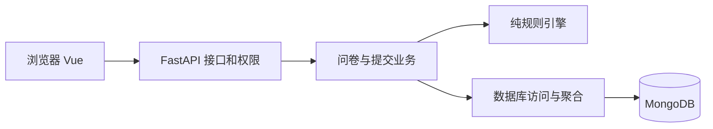

# 拾问问卷系统设计

## 目标和结构

系统覆盖第一阶段用户账号、问卷管理、条件跳转、答案校验、答卷保存及结果统计。前端为 Vue 3 与 TypeScript；后端为 FastAPI、Pydantic 和 PyMongo Async；唯一业务数据库为 MongoDB。

接口不承担跳转计算细节；业务组织状态和提交顺序；规则模块只接受定义和答案，返回规范化答案、真实路径和下一题。数据库连接在 lifespan 中创建和关闭，网络操作使用异步驱动。密码哈希在线程池运行，避免阻塞事件循环。

## 集合设计

| 集合 | 字段与含义 |
|---|---|
| users | `_id` 为 UUID 字符串；`username` 展示名；`username_key` 为 NFKC、去首尾空格、casefold 后的唯一值；`password_hash`；`created_at` |
| surveys | `_id`、`owner_id`、随机 `public_code`；标题说明；状态截止时间；匿名和重复设置；题目数组；三类版本；创建更新时间 |
| responses | `_id`、`survey_id`、`respondent_id`；定义版本；匿名及单次限制标记；答案数组；服务端计算的路径；请求 ID、请求摘要、受理时间 |
| sessions | `_id` 为随机令牌 SHA-256 哈希；用户 ID；CSRF 令牌；创建及过期时间 |

题目结构包括稳定 `id`、类型、标题说明、必答、选项、校验限制和跳转配置。单选答案存选项 ID，多选存去重后排序的 ID 数组，文本存去首尾空白字符串，数字存数值。未填写的可选题不保存答案，但保留在访问路径中。

问卷定义一起读取且数量有界，嵌入题目减少拼装和跨文档更新。答卷持续增长，独立保存避免无界数组及 MongoDB 16 MiB 文档限制。关系型数据库同样能实现问卷，但课程要求 MongoDB；本设计按读取和更新方式建模，而非将关系表机械翻译为集合。选择题、文本、数字可以在同一嵌套结构中表达，单份答卷可一次原子插入。

## 索引与一致性

| 索引 | 约束或查询 |
|---|---|
| users.username_key 唯一 | 并发注册不出现同名账号 |
| surveys.public_code 唯一 | 分享码定位 |
| surveys(owner_id, created_at DESC) | 所有权过滤及问卷列表排序 |
| responses(survey_id, submitted_at DESC) | 答卷分页、聚合前过滤 |
| responses(survey_id, respondent_id, request_id) 唯一 | 同一次请求只落一份 |
| responses(survey_id, respondent_id) 条件唯一 | `single_submission=true` 时每账号一份 |
| sessions.expires_at TTL | 后台清理过期会话 |

初始化实现于 database.py，重复执行设置 validator 和索引，不删除业务数据。数据库验证字段、类型、状态、数组结构和上限；应用验证跨字段约束、引用、路径及权限。MongoDB 没有为这些引用提供外键，不能将结构验证误写为全部业务约束已由数据库保证。

草稿整体更新在过滤条件中同时检查 `_id`、`owner_id`、`revision` 和 `status=draft`，成功更新后递增 revision。发布和保存使用同样的版本检查，避免检查旧内容后发布新内容。提交以唯一索引处理并发，不以先查询再插入代替数据库约束。统计从答卷实时聚合，不维护可能失步的累计计数。

编辑器更新截止时间时，只采用服务端返回的管理元数据及新 revision，保留本地题目、标题、说明和填写设置，也保留未保存标记。用户仍需保存草稿才能持久化这些编辑。请求失败时保留编辑内容和设置弹窗；请求期间禁用重复操作。

## 跳转与校验

题目数组是唯一题序来源，规则数组是唯一优先级来源。第一条匹配规则生效；否则走默认目标。NEXT 表示下一题，最后一题的 NEXT 等于 END。只支持当前题条件及向后跳转。可选题留空不匹配条件，走默认目标。

| 类型 | 条件及校验 |
|---|---|
| 单选 | eq；选项必须存在 |
| 多选 | contains_any / contains_all；有效 ID、不重复、最少和最多数量 |
| 文本 | 必答、首尾空白处理、Unicode 码点长度；最长 10000 码点 |
| 数字 | eq / gt / gte / lt / lte；有限值、上下界、整数；绝对值不超过 2^53-1 |

发布检查目标题序、选项引用、运算符、配置范围、ID 唯一和题干；结构不可达题目提示警告，不声称能穷举全部条件的可满足性。最多 100 题、每题最多 50 选项及 20 条规则，请求体最多 1 MiB。

必答文本题不能设置最多 0 字；可选文本题仍可设置此限制并留空。整数题的上下限与安全整数范围取交集，再检查是否至少包含一个整数，避免发布 0.1～0.9 等无法输入合法整数的配置；包含端点、单侧限制和未限制范围均按同一口径处理。

下一步接口接收当前题及此前答案，从首题重新计算；不相信客户端声明的进度。最终提交再次重放完整路径，拒绝重复 ID、未知题目和路径之外答案，仅校验实际经过的必答题。前端修改历史答案后删除后续旧路径答案。预览走同一引擎但不写入答卷。

## 提交、统计与边界

请求摘要基于规范化答案、定义版本及匿名选择。相同请求 ID 和相同摘要返回原回执；不同摘要冲突。成功重试检查先于关闭、截止和禁止重复检查。主动再填创建新请求 ID。网络提交结果不明时前端冻结这次提交内容，并以同一编号重试。

最终校验后再次读取问卷状态和截止时间；读取时仍开放的提交视为已受理，允许在随后关闭后完成插入。这里不提供“关闭返回后绝不出现任何先前在途写入”的跨集合线性化保证。无需事务即可保证单答卷完整性及唯一约束。

统计按答卷份数：总提交数、到达数、有效回答数、跳过数、到达但留空数分别计算。选项比例分母为该题有效回答数，零选择也返回；多选比例之和可大于 100%。数字平均值不包含跳过或未填，无有效数值时返回 null。文本和数值内容分页。

## 安全与演进

会话令牌用安全随机数生成，Cookie 为 HttpOnly、SameSite=Lax，生产启用 Secure；服务端主动检查过期并支持注销。写操作检查 CSRF，存在 Origin 时校验允许来源。注册和登录每 IP 每分钟最多 20 次，限流是单进程临时状态，生产默认单 worker；未来多实例需共享限流。所有管理读取和更新按 owner_id 过滤。匿名输出采用字段白名单，不返回 respondent_id、请求 ID 或摘要；用户自己写入文本的身份内容不自动脱敏。

schema_version 表示存储结构，definition_version 表示答卷对应问卷定义，revision 表示并发修改版本。第二阶段增加题目版本，仍不允许编辑已发布的问卷；definition_version 继续保持原语义。题库版本号和问卷定义版本不是同一层级。

## 第二阶段：题库、版本、权限与快照

保留原四个集合，新增 question_banks（个人分组）、questions（逻辑题目）、question_versions（不可变内容）。版本独立保存，避免题目历史无限嵌入一个文档。共享名单最多 100 个用户；题库不嵌入题目 ID 数组。完整 MongoDB validator 和索引的可执行实现仍在 backend/app/database.py。

question_banks 保存 owner_id、name、description、archived、revision 和时间。questions 保存 owner_id、bank_id、shared_with、status、archived、version_counter、revision、derived_from、creation_hash 和时间。status=creating 的未完成题目不显示，v1 成功插入后才激活为 active。

question_versions 保存 question_id、version_no、parent_version_id、restored_from_version_id、content、created_by、request_id、payload_hash 和 created_at。content 仅有 type、title、description、required、options、validation，不含 routing。所有保存使用 POST 新增，API 没有覆盖或删除版本的入口。恢复也新增版本；从同一父版本保存可以产生分支。

新增唯一索引 (question_id, version_no)、(created_by, request_id)，以及所有者题库索引、题目归属索引、shared_with 索引和 surveys(owner_id, questions.source.question_id) 反向引用索引。原有索引保留。

问卷题目保留 id（本问卷的题位身份），另外可选 source={question_id, version_id}。题干、选项、校验与跳转依然完整嵌入问卷，填写不依赖题库查询。重复加入相同版本时分配不同题位，答案和跳转仍使用题位 ID。从题库导入默认 NEXT；草稿换版保留题位与原跳转，校验失败必须修复后才能发布。发布和关闭后的定义不提供换版。

保存来源时，后端逐字段核对不可变版本内容，拒绝伪造或修改后继续声明旧来源。已存在的同题位同来源快照可在撤销授权或归档后继续保存；新增题位、更换版本、另存新题需要当前有效授权。不能通过删除 source 字段修改原引用，可删除原题位后创建新的独立题位。

共享按规范化用户名解析为用户 ID，授权整个逻辑题目及后续版本，只授使用权。另存题归接收者，derived_from 记录原题及版本。题目与题库归档均保留版本和历史问卷。撤销共享后，历史使用者只能读取自己问卷已经引用的版本；详情、历史列表、统计均不能泄露未被其引用的私有新版。

版本号通过单文档 $inc 分配，再插入唯一版本。失败可留下号段空缺，最新版本按成功插入的最大 version_no 查询。请求编号与规范化内容摘要确保相同请求重试返回相同版本；同编号不同内容冲突。首次创建的题目、版本 ID 由用户和请求编号确定，允许 creating 状态中断恢复。不依赖跨文档事务。这里不承诺跨集合归档操作的严格线性化，也不进行多实例吞吐量推算。

跨卷查询先按当前用户 owner_id 过滤问卷，再将对应题位映射到每个不可变版本，最后对本人答卷聚合。选项统计分母为有效作答次数；数字给出有效数、均值、极值、频次分布，原始值与频次分页。答卷份数与题位机会、有效作答次数分开；未到达=题位机会-到达，到达未答=到达-有效作答。不同版本分别返回，不自动合并不同单位或选项含义。

迁移为每个旧问卷题位创建独立、确定性的题目和 v1，不按相同文本合并。只增补 source 并递增 revision、升级 schema_version=2，原有题目、路由、分享码、definition_version、答案、路径、请求编号和摘要不改写。备份 v2 增加三个题库集合，恢复继续接受 v1，sessions 仍不进入备份。

设计参考：[MongoDB 文档版本模式](https://www.mongodb.com/docs/manual/data-modeling/design-patterns/data-versioning/document-versioning/)、[单文档原子性](https://www.mongodb.com/docs/manual/core/write-operations-atomicity/)、[事务部署条件](https://www.mongodb.com/docs/manual/core/transactions-production-consideration/)。

## 参考资料

- [MongoDB 官方 FastAPI 示例](https://github.com/mongodb-developer/mongodb-pymongo-fastapi)：连接生命周期和驱动用法。
- [MongoDB 条件索引](https://www.mongodb.com/docs/manual/core/index-partial/)与[单文档原子性](https://www.mongodb.com/docs/manual/core/write-operations-atomicity/)：并发约束和更新。
- [MongoDB 无界数组反模式](https://www.mongodb.com/docs/manual/data-modeling/design-antipatterns/unbounded-arrays/)：嵌入和引用选择。
- [OWASP 会话管理](https://cheatsheetseries.owasp.org/cheatsheets/Session_Management_Cheat_Sheet.html)：Cookie、过期和注销。
- [Formbricks](https://github.com/formbricks/formbricks)：研究问卷编辑、填写、分析的交互；未使用其系统或代码。
